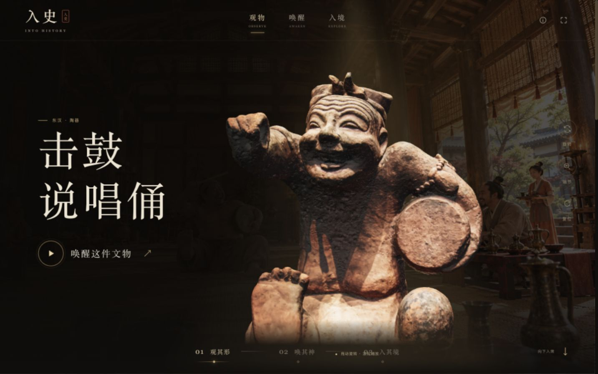

# 入史 · 文物互动展厅

以东汉击鼓说唱俑为主的文物互动演示：旋转本地 3D 模型、观看文物活化影片，再进入可拖拽的 180° 历史现场。

[GitHub 仓库](https://github.com/lapsea/into-history) · 目前提供源码和本地运行，未部署线上演示。



## 启动

需要 Node.js 20.11 或更新版本，首次运行执行 `npm ci` 安装锁定版本的依赖。

```sh
npm run dev
```

访问 http://127.0.0.1:4173/ 。不能直接双击 index.html：ES modules、视频及 WebGL 纹理需要通过 HTTP 服务加载。

如果端口已占用，可使用 `PORT=4174 npm run dev`。

## 已实现的体验

- 黑金沉浸式文物首屏，文物信息、细节说明与 3D 模型入口。
- 首页直接加载本地 GLB 模型，由 Three.js 实时渲染，无需点击进入或连接 Sketchfab。拖动旋转、滚轮/双指缩放；首页默认采用放大视角，侧边旋转按钮切换自动旋转，复位恢复放大的初始视角。键盘方向键旋转，Home 复位。
- 三个文物切换时加载对应本地模型；加载中显示进度，失败可重试。离开视口和后台标签页时停止绘制。
- 首页模型向中央移动。点击「唤醒这件文物」后，影片在原 3D 展示位置交叠淡入播放，不打开弹窗；保留播放/暂停、返回模型控制，3D 一直保留在底层，关闭或播放结束时自动淡回模型。影片已加宽至接近首页宽度，文字叠在视频上；说唱俑模型大小和初始角度按视频尾帧校准。说唱俑视频跳过开头 0.25 秒黑场。
- 说唱俑全景模块初始显示 `assets/videos/storyteller-transform.mp4`，进入视口后自动播放。播放完后冻结末帧，待新版全景视频首帧就绪，在同一 WebGL 画布中做 850 毫秒叠化，并用 1.6 秒的匹配视角展开到可拖拽全景。不同素材有构图/动作差异，通过对齐和叠化弱化接点，不承诺逐像素无缝。
- 全景模块仅播放新版动态现场；下方按钮仍可打开独立表演视频。已移除静态全景、模式切换和视频左上角信息。
- WebGL 部分球面全景：水平覆盖 180°，初始水平视野桌面 78°、手机 58°。只展示素材的一部分，支持拖拽、方向键、双指缩放、滚轮缩放、复位与全屏。
- 变身片段与动态现场按顺序静音播放，全景循环；离开视口、切换文物或进入后台时暂停；不再回退静态图片。WebGL 不可用时使用可平移缩放的原生视频。
- 原文物卡片区已改为七件文物环形 3D 展台。图片上方独立显示金色居中标题「珍藏未尽」，模型区域不显示名称等文字。左右拖动旋转，模型自动吸附到正前方；点击侧面模型先将它转到前方。
- 点击前方说唱俑、长信宫灯或将军俑，会切换首页对应文物；点击新增的发髻女子、青铜人头像、三彩马或唐代坐姿仕女，会打开无文字的模型近观窗口，支持旋转、缩放、复位和关闭。
- 展台支持方向键切换、回车打开、Home 回到首件。鼠标滚轮始终正常滚动页面，不再控制展台；触摸屏保留纵向页面滚动。
- 手机布局、键盘操作、原生无障碍对话框与减少动态效果偏好。

## 素材与显示边界

- 网页视频使用 H.264、无声、faststart 以保证浏览器兼容。博物馆视频为 `assets/site/museum.mp4`；新版全景 `视频-东汉宴饮说唱表演视频-全景new.mov` 的播放副本为 `assets/site/panorama-new.mp4`（3358 × 1440，18.63 秒）。
- `assets/site/*.jpg` 为用户视频提取的预览帧。
- `assets/site/storyteller-cutout.png` 为模型加载期间的低透明度占位图，加载完成后隐藏。首页实际展品是 WebGL 实时 3D。
- `assets/models/*.glb` 为网页优化副本：Meshopt 压缩、纹理缩至最高 2048 像素并转换为 WebP；说唱俑由约 250 万面减至约 75 万面。纹理已打包进 GLB；不再保留原始模型和单独纹理。
- 将军俑原导出文件的 UV 仅使用纹理的 1/16 区间，网页模型已展开 UV 并打包完整纹理，修正贴图错位。
- 可通过 `npm run prepare-ring` 从网页模型重建展台用轻量副本。环形展台使用约 74 万面的七件模型与最高 1024 像素纹理，近观使用较精细的网页模型。模型解码器、Three.js 和媒体资源均在本机加载，无需外部 CDN。
- 所有视频默认静音。
- 目录中的兵马俑模型为站立将军俑，因此页面按「将军俑」标注，没有使用先前讨论的跪射俑名称。
- 动态全景来自生成式视频，不是真实空间测量的等距柱状摄影。当前通过部分球面映射做展示校准；可能存在透视形变。初始视角按新版视频的站立动作重新取景。
- 全景不能绕到素材范围外，也不能在场景中自由走动。
- 历史空间、人物动作和复活影像属于创意演绎，页面已标明。

## 工程结构

- `index.html`：页面、原生对话框与图标。
- `style.css`：桌面与手机视觉。
- `app.js`：模型、影片、文物切换、热点与全屏。
- 环形展台使用生成的博物馆摄影风格背景图，中央底座固定在图片中；只旋转文物，不旋转背景和底座。前方模型落点按图片底座台面校准，并适配窄屏裁切。已移除整体亮度调节。兵马俑在环形展台中额外放大 12%；偏亮文物仍保留单独的材质校正。

- `assets/site/museum-gallery-background.webp`：固定博物馆背景和底座。
- `artifact-lighting.js`：偏亮文物的统一材质调整。
- `collection-ring.js`：七件文物的环形位置、透视层次、拖拽与射线点击。
- `model-viewer.js`：本地模型加载、灯光、材质、相机和 OrbitControls 交互。
- `scripts/prepare-ring.mjs`：环形展台轻量 GLB 副本生成。
- `hero-film.js`：首页 3D 与原位影片的状态、淡入淡出和播放控制。
- `panorama.js`：单画布双视频序列与全景查看器；WebGL 不可用时退回原生视频平移。
- `server.mjs`：仅监听本机，支持视频 HTTP Range 与中文路径。
- `assets/images/`：历史场景背景图片。
- `assets/videos/`：文物活化、变身与独立表演影片。

语法检查：`npm run check`。

## 替换素材

视频地址和文物信息集中在 `app.js` 的 `artifacts` 对象；首页模型为 `assets/models/storyteller.glb`、`lamp.glb`、`general.glb`；环形展台的七件模型列表在 `collection-ring.js` 的 `collectionItems` 中，轻量模型位于 `assets/models/ring/`。动态全景视频地址在 `index.html`；视角与覆盖范围在 `panorama.js`。修改后刷新浏览器即可。

运行时模型、视频、图片及 Three.js 均从本机加载；首次安装依赖需要连接 npm。页面内的藏品资料链接指向外部网站。项目与所引用博物馆没有隶属关系，场景与影像为创意演绎。

## 仓库范围

项目仅保留网页使用的优化模型、背景和视频。原始模型、单独纹理、已转码的原始 MOV、旧版全景视频和未引用照片已按用户要求删除；依赖原始模型的优化脚本也已移除。`prepare-ring` 使用仓库内优化模型生成展台副本。安装依赖后即可运行网站。

早期设计稿、角色三视图、全景概念稿、验收截图、未使用的旧代码与媒体已清理。公开仓库不代表为代码或素材额外授予通用开源许可。视频素材为作者原创，未经允许不得商用。

## 素材来源

- **视频素材**：作者原创，未经允许不得商用。
- **3D 模型素材**：来自 [Sketchfab](https://sketchfab.com/)。
- 图片及场景背景由项目提供者提供。
